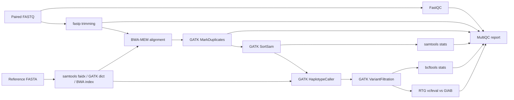

# ngs-variant-pipeline

A Nextflow (DSL2) pipeline for germline short-variant calling: paired-end FASTQ in, filtered and
benchmarked VCF out. It follows the GATK best-practices path (BWA-MEM, MarkDuplicates,
HaplotypeCaller, hard filtering) and can score its calls against a Genome in a Bottle (GIAB)
truth set with RTG `vcfeval`, so every change to the pipeline can be checked for accuracy.

## Workflow



Reference indexes are built once and shared by every sample. Each tool runs in its own pinned
conda environment (or BioContainers image), and every process reports its software version into
the MultiQC report.

## Results

HG002 (GIAB Ashkenazi son), NovaSeq PCR-free 35x, GRCh38 chr20:10,000,000-10,200,000
(25,485 read pairs). PASS calls compared with the GIAB v4.2.1 benchmark inside its confident regions:

| Type  | TP  | FP | FN | Precision | Recall | F1     |
|-------|-----|----|----|-----------|--------|--------|
| SNP   | 372 | 1  | 2  | 0.9973    | 0.9947 | 0.9960 |
| INDEL | 57  | 1  | 1  | 0.9828    | 0.9828 | 0.9828 |

Once the conda environments exist, the run takes under two minutes on a laptop, most of it
building the BWA index for chr20.

## Quick start

Requirements: Nextflow >= 25.04 (Java 17+) and conda/mamba. Results above come from the `conda`
profile; a `docker` profile using the matching BioContainers images is also included.

```bash
# 1. Build the test dataset (reference, HG002 reads, GIAB truth set for the region).
#    Needs curl, samtools, bcftools and tabix on PATH.
scripts/fetch_test_data.sh chr20:10000000-10200000 test

# 2. Run the pipeline on it.
nextflow run main.nf -profile test,conda
```

Results land in `results/`; open `results/multiqc/multiqc_report.html` for QC and the benchmark table.

The fetch script takes any chr20 region, e.g. `scripts/fetch_test_data.sh chr20:10000000-15000000 chr20_5mb`
for a larger 5 Mb test.

### Your own data

```bash
nextflow run main.nf -profile conda \
    --input samplesheet.csv \
    --fasta GRCh38.fa \
    --intervals targets.bed \
    --truth_vcf truth.vcf.gz \
    --truth_bed confident.bed
```

`--intervals` (restrict calling to a BED) is optional. `--truth_vcf` and `--truth_bed` are optional
but must be given together; the truth VCF needs a `.tbi` index next to it.

`samplesheet.csv`:

```csv
sample,fastq_1,fastq_2
HG002,/path/HG002_R1.fastq.gz,/path/HG002_R2.fastq.gz
```

## Outputs

| Path | Contents |
|------|----------|
| `qc/` | FastQC, fastp, MarkDuplicates metrics, samtools stats, bcftools stats |
| `alignment/` | Duplicate-marked, coordinate-sorted BAM + index |
| `variants/raw/` | HaplotypeCaller VCF |
| `variants/filtered/` | VCF with hard-filter annotations in the FILTER column |
| `benchmark/` | vcfeval output and a per-type precision/recall/F1 table |
| `multiqc/` | Combined report, including software versions |
| `pipeline_info/` | Nextflow timeline, execution report and trace |

## Design decisions

- **Hard filters instead of VQSR.** VQSR needs many thousands of variants to train its model, which a
  single sample or targeted region doesn't provide. The pipeline applies GATK's recommended
  single-sample hard filters (QD, QUAL, SOR, FS, MQ, rank-sum tests), separately for SNPs and indels.
- **RTG vcfeval for benchmarking.** It compares haplotypes rather than exact VCF records, so the same
  variant written two different ways (common for indels) is still counted as a match. Scoring is
  restricted to GIAB's confident regions, where the truth set is reliable.
- **Small, real test data.** The test set is a real 35x HG002 sample sliced to 200 kb, not simulated
  reads, so the benchmark reflects real sequencing errors while still running in minutes.
- **Reproducibility.** Tool versions are pinned per module, versions are collected through a Nextflow
  topic channel into the report, and resource requests are capped to the machine via `resourceLimits`.
- **Retries.** Tasks killed for running out of memory (exit 137/140/143) are retried once with more memory.

## Project layout

```
main.nf               workflow
nextflow.config       parameters, profiles, reports
conf/                 resources (base), publishing (modules), test dataset (test)
modules/<tool>/       one process per tool, each with its own conda environment.yml
scripts/              test-data download script
assets/               MultiQC configuration
```

## Roadmap

- nf-test unit tests for each module and GitHub Actions CI on the Docker profile
- Joint genotyping (GVCF mode + GenotypeGVCFs) for cohorts
- DeepVariant as an alternative caller, compared on the same benchmark
